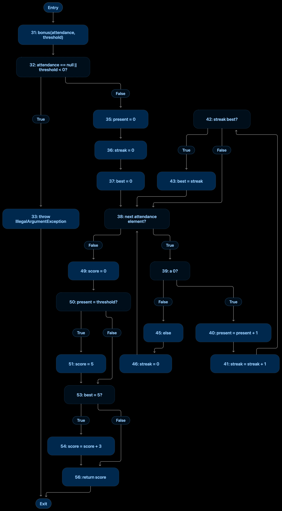

# F.CSA313 — Лаборатори 10: Өгөгдлийн урсгалын тест

**Оюутан:** Ц.Бэлгүтэй  
**Оюутны код:** B232270053  
**Огноо:** 2026-11-17

## 1. Лабораторийн зорилго

Энэхүү лабораторийн ажлаар Java програмын өгөгдлийн урсгалыг шинжилж, Definition-Use (DU) хосуудад үндэслэн тест зохиов. `DataFlowTargets` классын `gcd()` болон `bonus()` функцүүдэд All-Defs болон All-DU-Pairs тестийн шалгуурыг хэрэгжүүлж, JaCoCo ашиглан branch coverage-ийг хэмжив. Мөн тестийн үр нөлөөг шалгахын тулд гурван mutation туршилт хийв.

**Анхаарах зүйл:** Лабораторийн зааврын дагуу `src/main/java/mn/edu/must/sqat/DataFlowTargets.java` файлын үндсэн кодыг өөрчлөөгүй. Mutation туршилтын үед түр өөрчлөөд, туршилт бүрийн дараа эх хувилбарыг сэргээсэн.

## 2. Орчны мэдээлэл

### Java хувилбар

```text
openjdk version "23.0.2" 2025-01-21
OpenJDK Runtime Environment Homebrew (build 23.0.2)
OpenJDK 64-Bit Server VM Homebrew (build 23.0.2, mixed mode, sharing)
```

### Maven хувилбар

```text
Apache Maven 3.9.9
Maven home: /opt/homebrew/Cellar/maven/3.9.9/libexec
Java version: 23.0.2
Default locale: en_US, platform encoding: UTF-8
OS name: "mac os x", version: "14.5", arch: "aarch64", family: "mac"
```

**Төслийн тохиргоо:** Maven, JUnit 5, JaCoCo, Java 17 compile target.

## 3. A хэсэг — gcd() функцийн DU шинжилгээ

`gcd(int x, int y)` функц нь Евклидийн алгоритмаар хамгийн их ерөнхий хуваагчийг олно.

### 3.1 Definition-Use хосууд

| Хувьсагч | Definition | Use | Тайлбар |
|---|---:|---:|---|
| x | 13 | 16 | `tmp = x % y` доторх хэрэглээ |
| x | 13 | 20 | `return x` |
| x | 17 | 16 | Дараагийн давталтын хэрэглээ |
| x | 17 | 20 | Давталт дууссаны дараах хэрэглээ |
| y | 13 | 15 | `while` нөхцөл |
| y | 13 | 16 | Үлдэгдэл тооцох |
| y | 13 | 17 | `x = y` |
| y | 18 | 15 | Дараагийн давталтын нөхцөл |
| y | 18 | 16 | Дараагийн давталтын үлдэгдэл |
| y | 18 | 17 | Дараагийн давталтын оноолт |
| tmp | 16 | 18 | `y = tmp` |

`while` нөхцөлийн true/false үр дүнг тестүүдээр шалгасан. Мөн `x`, `y` хувьсагчийн давталтын өмнөх болон дараах тодорхойлолтуудаас хэрэглээ хүртэлх замыг хамруулсан.

### 3.2 Тестүүд

| Тест | Оролт | Хүлээгдэж буй үр дүн | Зорилго |
|---|---|---:|---|
| TC01 | `gcd(7, 0)` | 7 | Давталт огт ажиллахгүй |
| TC02 | `gcd(12, 8)` | 4 | Давталт олон удаа ажиллана |

Тестүүд `GcdTest.java` файлд байрлана.

## 4. B хэсэг — bonus() функцийн өгөгдлийн урсгал

### 4.1 Control Flow Graph

`bonus()` функцийн Control Flow Graph:



CFG-ийн зангилаанууд нь эх кодын мөрийн дугаартай таарна. Шийдвэрийн зангилаануудын true/false салааллыг болон давталтын буцах замыг дүрсэлсэн.

### 4.2 Хувьсагчийн Definition ба Use

| Хувьсагч | Definition мөр | Use мөр | Use төрөл |
|---|---|---|---|
| attendance | 31 | 32, 38 | Predicate, control |
| threshold | 31 | 32, 50 | Predicate |
| a | 38 | 39 | Predicate |
| present | 35, 40 | 40, 50 | Computational, predicate |
| streak | 36, 41, 46 | 41, 42 | Computational, predicate |
| best | 37, 43 | 42, 53 | Predicate |
| score | 49, 51, 54 | 54, 56 | Computational |

### 4.3 DU хосуудын хүснэгт

Хүснэгтэд `Definition → Use` хэлбэрээр боломжит DU замуудыг харуулав. Predicate use-тэй мөрүүдийн true/false салааллыг холбогдох тестүүдээр шалгасан.

| Хувьсагч | DU хос | Use төрөл |
|---|---|---|
| attendance | 31 → 32 | p-use |
| attendance | 31 → 38 | c-use / loop control |
| threshold | 31 → 32 | p-use |
| threshold | 31 → 50 | p-use |
| a | 38 → 39 | p-use |
| present | 35 → 40 | c-use |
| present | 35 → 50 | p-use |
| present | 40 → 40 | c-use |
| present | 40 → 50 | p-use |
| streak | 36 → 41 | c-use |
| streak | 41 → 41 | c-use |
| streak | 41 → 42 | p-use |
| streak | 46 → 41 | c-use |
| best | 37 → 42 | p-use |
| best | 37 → 53 | p-use |
| best | 43 → 42 | p-use |
| best | 43 → 53 | p-use |
| score | 49 → 54 | c-use |
| score | 49 → 56 | c-use |
| score | 51 → 54 | c-use |
| score | 51 → 56 | c-use |
| score | 54 → 56 | c-use |

**Хүрэх боломжгүй DU замын тайлбар:**

- `streak`-ийн 36-р мөрийн тодорхойлолтоос 42-р мөрийн хэрэглээ хүртэл шууд хүрэх боломжгүй. Учир нь 41-р мөрөнд `streak` дахин тодорхойлогдоно.
- 46-р мөрийн тодорхойлолтоос 42-р мөрийн хэрэглээ хүртэл мөн шууд хүрэх боломжгүй. Дараагийн эерэг утгатай өдөр 41-р мөрөнд `streak`-ийг дахин тодорхойлсны дараа 42-р мөрөнд хүрнэ.
- Иймээс эдгээр замд өмнөх тодорхойлолт хэрэглээнд хүрэхээсээ өмнө хүчингүй болно (killed).

### 4.4 All-Defs тестүүд

`BonusAllDefsTest.java` файлд дараах тестүүдийг хэрэгжүүлсэн.

| Тест | Оролт | Хүлээгдэж буй үр дүн | Хамрах зорилго |
|---|---|---:|---|
| AD01 | `null`, мөн сөрөг threshold | Exception | Оролтын шалгалт |
| AD02 | `{1,1,0,1,1}`, threshold 3 | 5 | Ирц тоолох, streak reset |
| AD03 | `{1,1,1,1,1}`, threshold 5 | 8 | Урт streak, хоёр урамшуулал |
| AD04 | `{}`, threshold 0 | 5 | Хоосон массив |
| AD05 | `{1,0}`, threshold 2 | 0 | Threshold хангахгүй |

All-Defs шалгуурын гол шаардлага нь хувьсагч бүрийн тодорхойлолт дор хаяж нэг удаа хэрэглээнд хүрэх явдал юм. Эдгээр тестүүд параметр, эхний утга оноолт, давталтын үеийн шинэ тодорхойлолт болон онооны өөрчлөлтүүдийг хамруулсан.

### 4.5 All-DU-Pairs тестүүд

`BonusAllDUPairsTest.java` файлд DU хосуудыг шалгах тестүүдийг хэрэгжүүлсэн.

| Тест | Оролт | Хүлээгдэж буй үр дүн | Зорилго |
|---|---|---:|---|
| DU01 | `null`, мөн сөрөг threshold | Exception | Оролтын шалгалтын салааллууд |
| DU02 | `{}`, threshold 1 | 0 | Давталтгүй зам, эхний тодорхойлолтууд |
| DU03 | `{1,0,1,1}`, threshold 5 | 0 | Streak reset болон дахин эхлэх |
| DU04 | `{1,1}`, threshold 2 | 5 | Threshold урамшуулал |
| DU05 | `{1,1,1,1,1}`, threshold 6 | 3 | Зөвхөн дараалсан ирцийн урамшуулал |
| DU06 | `{1,1,1,1,1}`, threshold 5 | 8 | Хоёр урамшуулал хоёулаа |
| DU07 | `{1,1,0,1,1,1,1}`, threshold 7 | 0 | Нийт ирц ба хамгийн урт streak-ийг ялгах |

DU07 нь M2 mutation-ийг илрүүлэх зорилгоор нэмэгдсэн. Нийт ирц 6 боловч хамгийн урт дараалсан streak 4 тул анхны функц 0 оноо буцаана.

### 4.6 All-Defs ба All-DU-Pairs-ийн ялгаа

All-Defs нь хувьсагч бүрийн тодорхойлолт хэрэглээнд хүрсэн эсэхийг шалгадаг. Харин All-DU-Pairs нь тодорхойлолт бүрээс тухайн хувьсагчийн боломжит хэрэглээ хүртэлх замыг тус бүрээр нь хамруулахыг зорьдог. Иймээс All-DU-Pairs нь илүү нарийвчилсан шалгуур бөгөөд тодорхойлолтын дараалал, давталт, дахин оноолт, салааллыг илүү сайн шалгана.

## 5. JaCoCo coverage үр дүн

### 5.1 All-Defs

`results/jacoco-alldefs.csv`:

| Үзүүлэлт | Missed | Covered |
|---|---:|---:|
| Instructions | 3 | 78 |
| Branches | 0 | 16 |
| Lines | 1 | 23 |
| Complexity | 1 | 10 |
| Methods | 1 | 2 |

### 5.2 All-DU-Pairs ба эцсийн үр дүн

`results/jacoco-final.csv`:

| Үзүүлэлт | Missed | Covered |
|---|---:|---:|
| Instructions | 3 | 78 |
| Branches | 0 | 16 |
| Lines | 1 | 23 |
| Complexity | 1 | 10 |
| Methods | 1 | 2 |

**Branch coverage: 16/16 = 100%.**

Нэг мөрийн coverage дутуу байгаа нь `DataFlowTargets` классын implicit constructor юм. Зорилтот хоёр функцийн branch-ууд бүгд хамрагдсан.

## 6. C хэсэг — Mutation testing

Mutation бүрийг `DataFlowTargets.java` файлд түр хэрэгжүүлж, `mvn clean test` ажиллуулсан. Туршилтын дараа эх кодыг `git restore` ашиглан сэргээсэн.

| Mutation | Өөрчлөлт | Үр дүн | Тайлбар |
|---|---|---|---|
| M1 | 41-р мөрийн `streak = streak + 1;` мөрийг хассан | Killed | Streak тооцоолол буруу болж, тестүүд алдаа илрүүлсэн |
| M2 | 43-р мөрийн `best = streak;`-ийг `best = present;` болгосон | Killed | Эхний тестүүд илрүүлээгүй. DU07 нэмсний дараа буруу тооцооллыг илрүүлсэн |
| M3 | Давталтын дараа ашиглагдахгүй `int total = present + best;` хувьсагч нэмсэн | Survived | Програмын үр дүн өөрчлөгдөөгүй тул behavior-based тестүүд алдаа илрүүлээгүй |

### 6.1 Mutation туршилтын нотолгоо

- `results/mvn-test-M1.txt` — M1 mutation-ийн алдаатай тестийн үр дүн.
- `results/mvn-test-M2.txt` — M2 анхны тестүүдээр илрээгүй үр дүн.
- `results/mvn-test-M2-kill.txt` — DU07 нэмсний дараа M2 илэрсэн үр дүн.
- `results/mvn-test-M3.txt` — M3 mutation-ийн үед бүх тест амжилттай болсон үр дүн.

M2-ийн хувьд нийт ирц ба хамгийн урт дараалсан ирцийг ялгах нэмэлт тест хэрэгтэй байсан. M3 нь зөвхөн ашиглагдаагүй локал хувьсагч нэмсэн тул тестийн үр дүнд нөлөөлөөгүй. Ийм төрлийн асуудлыг тестээс гадна IDE-ийн static analysis эсвэл code inspection ашиглан илрүүлэх боломжтой.

## 7. Эцсийн тестийн үр дүн

Эцсийн `mvn clean verify` ажиллуулалтын үр дүн:

| Test class | Tests | Failures | Errors |
|---|---:|---:|---:|
| GcdTest | 2 | 0 | 0 |
| BonusAllDUPairsTest | 7 | 0 | 0 |
| BonusAllDefsTest | 5 | 0 | 0 |
| **Нийт** | **14** | **0** | **0** |

**Build status: BUILD SUCCESS**

Нотолгооны файлууд `results/` хавтсанд хадгалагдсан.

## 8. Дүгнэлт

Энэ лабораторийн ажлаар өгөгдлийн урсгалын тестийн All-Defs болон All-DU-Pairs шалгууруудыг хэрэгжүүлж сурлаа. `gcd()` функцэд хоёр тест зохиож, хувьсагчдын тодорхойлолт болон хэрэглээний хосуудыг шалгасан. `bonus()` функцийн CFG-г байгуулж, хувьсагч бүрийн definition-use хамаарлыг тодорхойлсон. All-Defs болон All-DU-Pairs тестүүдийн тусламжтайгаар оролтын шалгалт, давталт, streak reset болон онооны хоёр төрлийн урамшууллыг хамруулсан. JaCoCo-ийн эцсийн үр дүнгээр бүх 16 branch хамрагдаж, нийт 14 тест алдаагүй ажилласан. Mutation testing нь тестийн чанарыг үнэлэхэд чухал болохыг харуулсан бөгөөд M2 mutation-ийг илрүүлэхийн тулд DU07 тест нэмэх шаардлагатай болсон. Харин M3 шиг програмын үр дүнд нөлөөлөхгүй өөрчлөлтийг зөвхөн функциональ тестээр илрүүлэх боломжгүй тул static analysis болон code review мөн шаардлагатай.

## 9. AI ашигласан эсэх

Энэхүү лабораторийн ажлын явцад AI хэрэгслийг DU шинжилгээний ойлголт, тестийн хувилбар боловсруулах, Maven/JaCoCo үр дүнг тайлбарлах зорилгоор ашигласан. Код болон тестүүдийг локал орчинд ажиллуулж, үр дүнг өөрөө шалгав.